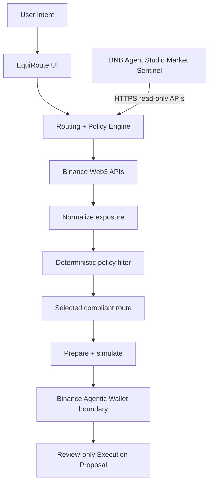
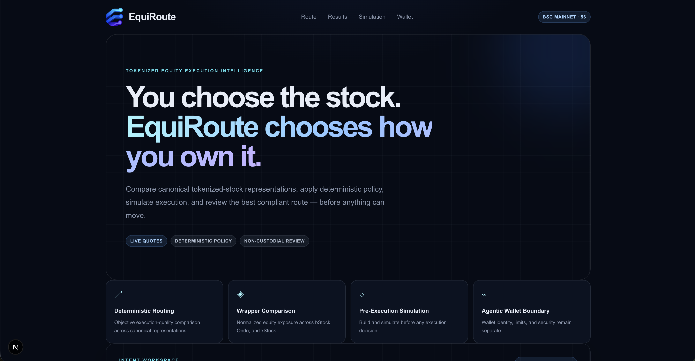
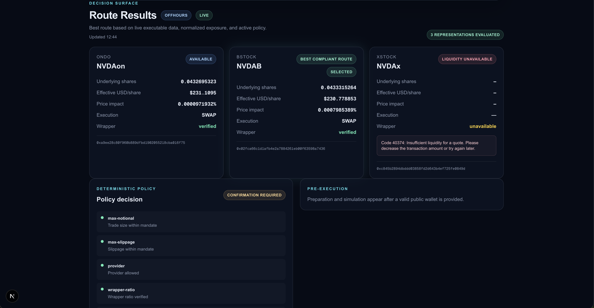
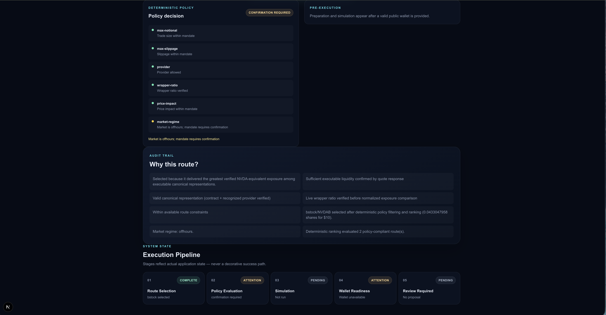

# EquiRoute

<p align="center">
  
</p>

<p align="center"><strong>You choose the stock. EquiRoute chooses how you own it.</strong></p>

<p align="center">
  Deterministic execution intelligence for tokenized equities on BNB Chain.
</p>

## The problem

A single stock can exist on-chain through multiple wrappers and providers. Those representations can differ in executable price, liquidity, wrapper/share ratio, execution venue, market regime, and policy compatibility. Users should not have to manually determine which tokenized representation provides the best compliant exposure.

## The solution

EquiRoute turns an exposure intent into an auditable, review-first execution path:

```text
Intent
  → canonical representation discovery
  → live executable quotes
  → wrapper/share normalization
  → deterministic policy filtering
  → best compliant route
  → transaction preparation
  → simulation
  → Agentic Wallet security boundary
  → user review
```

The router and policy engine are authoritative. LLMs do not select the winning route, loosen a mandate, or authorize execution.

## Key features

- **Multi-representation routing** across canonical bStock, Ondo, and xStock contracts.
- **Live Binance Web3 quotes** with provider, vendor, execution-mode, DEX, fee, gas, and liquidity metadata.
- **Verified wrapper/share normalization** using live RWA metadata and decimal-safe arithmetic.
- **Market-regime awareness** for regular hours, premarket, postmarket, off-hours, closed, paused, restricted, and unknown states.
- **Deterministic `ExecutionMandate` policy** for notional, slippage, price impact, providers, wrapper verification, market regime, and simulation requirements.
- **Policy filtering before ranking**, with an audit trail for economically superior routes rejected by policy.
- **Best-Execution and Pre-Execution Receipts** containing route facts, rejected alternatives, simulation, and readiness decisions.
- **Unsigned transaction preparation and simulation** without signing or broadcasting.
- **Binance Agentic Wallet boundary** for wallet identity, balances, quotas, settings, quote reconciliation, and readiness.
- **Token-security gate** using the documented Binance Web3 audit flow.
- **Audit-only Execution Proposal** with freshness and `authorization: "none"`.
- **EquiRoute Market Sentinel integration** through public HTTPS APIs.

## Supported tokenized representations

The current canonical NVDA registry includes:

| Provider | Symbol | BSC contract |
|---|---|---|
| bStock | `NVDAB` | `0x02fca66c1d1afb4e2a7884261eb00f63598a7436` |
| Ondo | `NVDAon` | `0xa9ee28c80f960b889dfbd1902055218cba016f75` |
| xStock | `NVDAx` | `0xc845b2894dbddd03858fd2d643b4ef725fe0849d` |

Availability is always determined by live API responses. A registered representation may be unavailable because of liquidity, market state, malformed metadata, or policy constraints.

## Architecture



EquiRoute and Binance Agentic Wallet are separate safety boundaries. BNB Agent Studio is a separate Sentinel runtime and wallet model; it is not interchangeable with Binance Agentic Wallet and no private keys are shared between them.

## Deterministic safety model

- Provider selection is deterministic.
- Financial comparisons use decimal-safe arithmetic rather than JavaScript floating-point decisions.
- Policy filtering occurs before route ranking.
- Unknown market state is never silently treated as regular trading.
- Simulation failure blocks readiness when the mandate requires simulation success.
- Wallet identity is checked across Agentic Wallet, preparation, swap transaction, and simulation.
- Agentic Wallet quote capability does not imply execution capability.
- Token-security audit unavailable means unavailable/acknowledgment-required, not safe.
- No LLM can authorize execution or override policy.

## Binance Agentic Wallet integration

EquiRoute can read the local/user-bound Agentic Wallet boundary through the documented `baw` CLI:

- connection status and wallet address
- BSC support
- USDT and BNB balance state
- quotas and daily limits
- abnormal-transaction handling and token scope
- Developer Mode status (informational only)
- runtime market-order quote capability
- quote reconciliation against EquiRoute output
- token-security audit state
- execution readiness and review-only proposal

The current build never enables Developer Mode, signs, submits approvals, broadcasts, or executes a trade. A cloud deployment without an authenticated local `baw` session reports Agentic Wallet as unavailable while core routing and policy remain usable.

## EquiRoute Market Sentinel

The separate **EquiRoute Market Sentinel** is a BNB Agent Studio workspace that calls EquiRoute over HTTPS. Configure it with:

```text
EQUIROUTE_BASE_URL=https://equiroute-lime.vercel.app/
```

[Equiroute live website](https://equiroute-lime.vercel.app/)

[Equiroute Sentinel Repository](https://github.com/ypszn/equiroute-sentinel)

The Sentinel is designed to:

- evaluate deterministic MarketWatch conditions
- call EquiRoute routing and policy APIs
- compare canonical representations
- monitor market-regime and execution-quality gaps
- expose findings through its documented task/tool interfaces
- optionally use testnet-safe x402/Agent Studio capabilities for its own operating costs
- produce an auditable report or Execution Proposal

It never overrides EquiRoute policy or authorizes a trade. Native continuous scheduling is not assumed; each watch is evaluated when the Sentinel is invoked or externally triggered.

## Market Watch

A watch can evaluate conditions such as:

- a selected provider changing
- xStock becoming executable
- effective USD/share falling below a threshold
- market regime changing
- a policy result becoming acceptable

The Sentinel consumes the resulting deterministic route and policy facts; it does not invent financial values or independently rank routes.

## Execution flow

1. Enter a stock ticker, notional, slippage, and optional public quote-context wallet.
2. Resolve canonical tokenized-equity representations.
3. Fetch live executable quotes concurrently.
4. Normalize wrapper output into underlying-share exposure.
5. Apply the user’s `ExecutionMandate`.
6. Select the best compliant route deterministically.
7. Optionally prepare and simulate an unsigned transaction.
8. Reconcile a fresh Agentic Wallet quote for the selected representation.
9. Evaluate token security, wallet state, policy, and readiness.
10. Produce a review-only Execution Proposal.

## API surface

| Method | Endpoint | Purpose |
|---|---|---|
| `GET` | `/api/health` | Lightweight liveness; no external calls. |
| `POST` | `/api/route` | Live routing, policy-aware selection, and Best-Execution Receipt. |
| `POST` | `/api/policy/evaluate` | Policy preview and route evaluation. |
| `POST` | `/api/prepare` | Fresh route, unsigned swap preparation, and simulation. |
| `GET` | `/api/agentic-wallet/status` | Safe local Agentic Wallet state. |
| `POST` | `/api/agentic-wallet/preflight` | Wallet-bound preflight and dual readiness. |
| `GET` | `/api/agentic-wallet/capabilities` | Read-only runtime quote capability probe. |
| `POST` | `/api/agentic-wallet/execution-gate` | Fresh quote reconciliation, security gate, and review-only proposal. |

The `userWalletAddress` accepted by `/api/route` and `/api/policy/evaluate` is public quote context only. It is not a signer or execution authorization.

## Environment variables

### Required for deterministic routing

```text
OC_API_KEY=your_binance_api_key_here
OC_SECRET_KEY=your_binance_secret_key_here
OC_BASE_URL=https://web3.binance.com/build
```

### Optional routing configuration

```text
OC_QUOTE_PATH=/api/v1/dex/aggregator/quote
OC_TIMEOUT_MS=15000
OC_RECV_WINDOW=10000
```

### Local Agentic Wallet only

```text
BAW_BIN=/absolute/path/to/baw
```

`baw` and its authenticated session are not required for `/api/route` or `/api/policy/evaluate`. Never use `NEXT_PUBLIC_` names for server credentials.

## Local development

Requirements: Node.js, npm, and the repository dependencies.

```bash
npm install
cp .env.example .env.local
# Fill server-side Binance values in .env.local.
npm run dev
```

Open `http://localhost:3000`.

For local Agentic Wallet inspection, install and authenticate the official Binance Agentic Wallet Skill/CLI separately. EquiRoute does not authenticate on the user’s behalf.

## Testing

```bash
npm test
npm run lint
npx tsc --noEmit
npm run build
git diff --check
```

The automated suite covers routing math, live-response normalization, mandate enforcement, preparation/simulation, wallet boundary behavior, runtime quote reconciliation, token-security handling, and execution-gate safety.

## Deployment

The public EquiRoute service is a persistent Next.js HTTPS application, suitable for a Next.js-compatible host such as Vercel:

- **Vercel / equivalent:** EquiRoute web and API service.
- **BNB Agent Studio:** separate Market Sentinel runtime calling EquiRoute through HTTPS.
- **Binance Agentic Wallet:** local/user execution-security boundary, not a cloud service dependency for routing.

Configure `OC_API_KEY`, `OC_SECRET_KEY`, and `OC_BASE_URL` as server-side hosting secrets. The deployed service must run in an environment where the Binance Web3 APIs are available under applicable service restrictions. No geo/compliance restriction should be bypassed.

Live quote and market requests use bounded timeouts and `cache: "no-store"`; they are not intended to be cached by the hosting platform. The API handlers use the Node.js runtime. No persistent writable filesystem is required.

## Product

### Intent-based tokenized-equity execution



EquiRoute lets the user choose the equity exposure while the system determines
the best compliant tokenized representation.

### Live representation comparison



Canonical representations are compared using live executable quotes, verified
wrapper ratios, normalized underlying exposure, price impact, market regime,
and deterministic policy.

### Deterministic execution gates



Routing, policy evaluation, simulation, wallet readiness, and human review are
explicit application states. EquiRoute never treats an unverified stage as
complete.

## Disclaimer

EquiRoute is hackathon/research software and is not financial advice. Routes depend on current liquidity, market state, provider responses, and API availability. Users remain responsible for wallet actions. The current build is review-first and does not automatically authorize or broadcast trades.

## License

This project is licensed under the MIT License. See [LICENSE](LICENSE).
